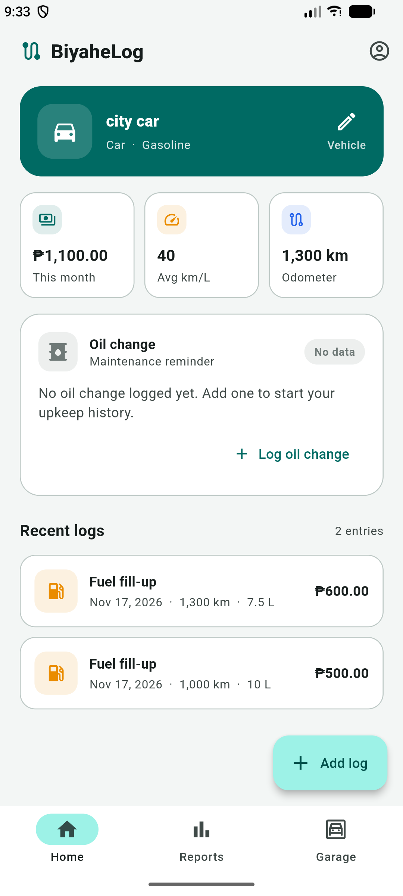

# BiyaheLog

Offline vehicle maintenance and fuel expense tracker built with Flutter. Works with any vehicle — motorcycle, tricycle, car, SUV/pickup, van, truck, bus, jeepney, or other.

## Features

- Local offline accounts with salted, hashed passwords (no network needed)
- Multiple vehicles per account, each with its own history and active vehicle switching
- Log fuel fill-ups, oil changes, repairs, and other expenses
- Fuel efficiency in km/L (or km/kWh for electric vehicles) and monthly spending reports
- Oil-change reminder based on distance or time
- Data stored locally in SQLite



## Getting started

```bash
flutter pub get
flutter run
```

Run the tests with:

```bash
flutter test
```
